

<picture><source media="(prefers-color-scheme: dark)" srcset="assets/hero-dark.svg"></picture>

<picture><source media="(prefers-color-scheme: dark)" srcset="assets/social-l-dark.svg"></picture><a href="https://sanchos.su"><picture><source media="(prefers-color-scheme: dark)" srcset="assets/social-1-dark.svg"></picture></a><a href="https://t.me/SANCHOS095"><picture><source media="(prefers-color-scheme: dark)" srcset="assets/social-2-dark.svg"></picture></a><picture><source media="(prefers-color-scheme: dark)" srcset="assets/social-r-dark.svg"></picture>

<picture><source media="(prefers-color-scheme: dark)" srcset="assets/about-dark.svg"></picture>

<picture><source media="(prefers-color-scheme: dark)" srcset="assets/stack-dark.svg"></picture>

<a href="https://github.com/Sanchos-dev/motiff"><picture><source media="(prefers-color-scheme: dark)" srcset="assets/project-motiff-dark.svg"></picture></a>&nbsp;<a href="https://github.com/Sanchos-dev/SanChat"><picture><source media="(prefers-color-scheme: dark)" srcset="assets/project-sanchat-dark.svg"></picture></a>

<a href="https://github.com/Sanchos-dev/cotl-save-sync"><picture><source media="(prefers-color-scheme: dark)" srcset="assets/project-cotl-save-sync-dark.svg"></picture></a>&nbsp;<a href="https://github.com/Sanchos-dev/kd-save-sync"><picture><source media="(prefers-color-scheme: dark)" srcset="assets/project-kd-save-sync-dark.svg"></picture></a>

<picture><source media="(prefers-color-scheme: dark)" srcset="assets/stats-dark.svg"></picture>

<picture><source media="(prefers-color-scheme: dark)" srcset="assets/streak-dark.svg"></picture>

<picture><source media="(prefers-color-scheme: dark)" srcset="assets/wave-dark.svg"></picture>

<a href="https://sanchos.su"><picture><source media="(prefers-color-scheme: dark)" srcset="assets/button-1-dark.svg"></picture></a>&nbsp;&nbsp;<a href="https://github.com/Sanchos-dev?tab=repositories"><picture><source media="(prefers-color-scheme: dark)" srcset="assets/button-2-dark.svg"></picture></a>

<a href="https://metawka.github.io/expressive-profile/?from=Sanchos-dev"><picture><source media="(prefers-color-scheme: dark)" srcset="assets/credit-dark.svg"></picture></a>

